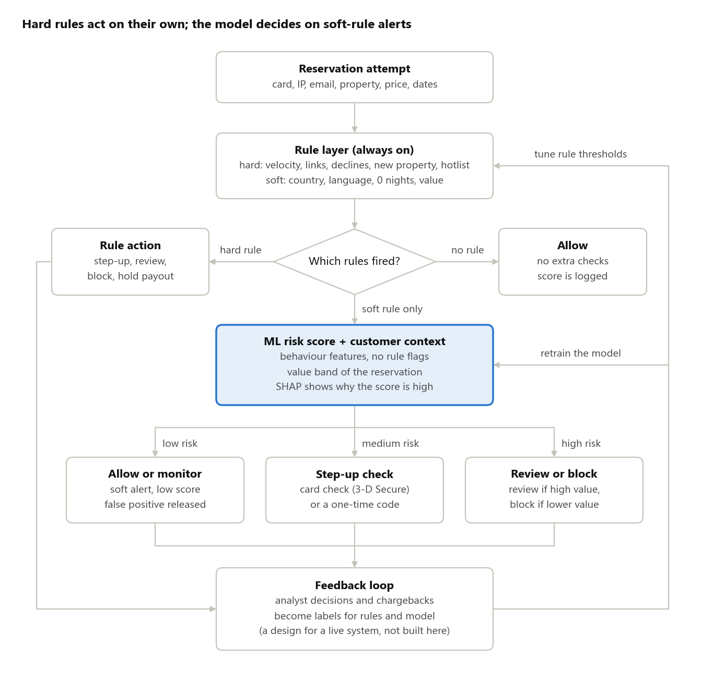

# Hybrid Fraud Detection for Online Accommodation Reservations

This project keeps the rule-based fraud checks in place and adds a machine learning layer on top of them. The goal is to cut the false positives that the rules create, while the rules keep catching real fraud. The data is a synthetic set of 79,557 payment attempts for accommodation reservations from January 2022.

## The business problem

Fraud rules catch real attacks, but they also stop many good customers. An online accommodation platform takes card and wallet payments when guests reserve a stay. Fraudsters use stolen cards, open fake accounts, and sometimes list fake properties to collect payouts. To stop them, the platform runs fixed rules on every payment attempt.

Rules are simple and easy to explain, so the business wants to keep them. Their weak point is that each rule looks at one signal only. For example, the rule "the booker's country is not the card's country" fires on 9,081 attempts (11.4%) in this data, and many of these are normal cross-border travellers. Every false alert has a cost:

- a good customer gets extra checks, or gives up and reserves somewhere else,
- an analyst spends time on a case that is not fraud,
- the property loses revenue.

The question for this project is: how can we keep the rules, but act less often and less strongly on the alerts that are not fraud?

## Goals and how we measure success

Success means fewer false alerts while at least 95% of the fraud value that the rules catch stays caught. Each goal has its own measure.

| Goal | How we measure it |
| --- | --- |
| 1. Find the fraud patterns in the data | Each pattern described with its size, its value in EUR and the signals behind it |
| 2. Turn the patterns into rules with clear actions | One rule per pattern, each with a default action |
| 3. Reduce the false positives of the rules with an ML layer | Share of friction actions (step-up check, review, block) that are not fraud, and attempts sent to manual review per day, for rules only and for the hybrid system |
| 4. Keep catching fraud while friction goes down | Fraud value caught (EUR) stays at 95% or more of what the rules alone catch |
| 5. Fit the action to the customer | Number and EUR value of good reservations that get a step-up check, a review or a block |

## The data

The dataset holds 79,557 payment attempts for accommodation reservations, made between 1 and 31 January 2022. It is synthetic: all IDs are hashed and the email domains are placeholder names, such as @papaya.com. There are no missing values and no duplicate rows. Source: synthetic transaction data from a fraud analytics case study.

| Item | Value |
| --- | --- |
| Payment attempts | 79,557 (2,439 to 3,308 per day) |
| Period | 1 to 31 January 2022 |
| Columns | 17 |
| Countries | 15 European countries, for bookers, cards and properties |
| Site languages | 15 |
| Properties | 51,775 |
| Payment methods | Visa, Mastercard, American Express, PayPal, Klarna |
| Reservation value | 200 to 4,999 EUR, median 2,614 EUR |

### Column dictionary

| Column | Type | Description from the source | How we read it |
| --- | --- | --- | --- |
| transaction_id | integer | Unique ID of the payment attempt |  |
| creation_date | date | Day the reservation was created (no time of day) |  |
| ip_id | text, hashed | ID of the IP address the booker used |  |
| credit_card_id | text, hashed | ID of the card used for the payment | The card or the payment account: all 8,373 PayPal and Klarna attempts also have one |
| email_id | text, hashed | ID of the booker's email address |  |
| email_domain | text | Domain of the booker's email address (placeholder names) |  |
| booker_country | text | Country the reservation was made from | The country the booker entered. It cannot come from the IP address, the card or the account: the same IP, card or email comes with up to 15 countries. In the normal attempts it matches the card country in 91% of the rows, in the attack attempts in 7% |
| card_issuing_country | text | Country where the card was issued | The country of the card or the payment account, for the same reason |
| hotel_country | text | Country of the property |  |
| hotel_id | integer | ID of the property (a hotel or another type of accommodation) listed on the platform |  |
| property_age | integer | Months since the property was listed on the platform, at the time of the reservation | One fixed value per property. It does not grow during the month |
| language | text | Language of the website the booker used |  |
| price_euro | decimal | Total value of the reservation in EUR |  |
| book_window | integer | Days between the reservation date and the check-in date |  |
| length_of_stay | integer | Nights between check-in and check-out |  |
| payment_method | text | Payment method used |  |
| auth_result | text | Answer of the payment provider to this attempt (see the next table) |  |

The descriptions come from the source of the data. Nobody can confirm them for us. Where the data does not fit a description, the last column says how we read the column and why. The data is synthetic, so these readings are our interpretation, not confirmed facts. They change no number in this project.

### Payment results (auth_result)

| Value | Meaning | Attempts | Share |
| --- | --- | --- | --- |
| AUTHORISED | The card issuer approved the payment, so the money can be collected | 65,871 | 82.8% |
| INSUFFICIENT_FUNDS_OR_LIMIT_EXCEEDED | Not enough money or credit limit on the card | 5,540 | 7.0% |
| ERROR | Not approved because of a technical processing error | 3,821 | 4.8% |
| REFUSED | Not approved, and no specific reason was given | 3,495 | 4.4% |
| FRAUD | Declined because the card issuer or the payment provider suspected fraud | 830 | 1.0% |

### Data quality

We ran 10 quality checks, and no row needed a fix. The checks cover dates, value ranges, text values and one value per ID. We did not remove or change any row. Three findings matter:

- **338 reservations have 0 nights.** We keep them, because rule R8 uses them as a warning sign.
- **PayPal and Klarna payments also have a card ID.** These 8,373 attempts have a credit_card_id and a card issuing country. We treat credit_card_id as the ID of the card or account behind the payment.
- **4 IPs, 5 cards and 10 emails come with more than one booker country.** A normal booker has one country, so this is not a data error. It is a trace of the attacks.

## Data limits and how we handle them

The data has no confirmed fraud label and no customer history, so the design must work around both.

| Limit | Why it matters | How we handle it |
| --- | --- | --- |
| No confirmed fraud label. FRAUD in auth_result is only a suspicion, and there are no chargebacks. | In a first check, the FRAUD rate was close to 1% in every country, payment method, price band and day. A quick model trained on this label scored ROC AUC 0.52, close to random. | We build an investigation label: we link attempts that share a card, email or IP, and an attempt counts as fraud if its cluster has more than one attempt. In this data, every such cluster was reviewed and confirmed as an attack. auth_result stays as a separate signal. |
| No customer ID and no reservation history | 98% of attempts use a card and an email that appear only once in the month, so we cannot tell a new customer from a loyal one. | We use value and behaviour signals from the reservation itself, and we list the CRM fields a real system would add (see Customer context). |
| Dates only, no time of day | We cannot put the attempts of one day in order. | We count velocity per day, and decline history uses previous days only. Same-day counts can include later attempts, so the results are a little optimistic. |
| One month of data | Seasonal effects and slow attacks are not visible. | We split by time: we build on days 1 to 14 and test on days 15 to 31. |
| 338 reservations have 0 nights | A stay of 0 nights is not possible. | We keep them, and soft rule R8 flags them, so the risk score decides on them. The data cannot tell if they are test reservations or a data error. |
| Synthetic data | Patterns may be cleaner than in real life. | We present the results as a proof of concept, not as expected production numbers. |

Questions that the data in hand cannot answer:

- Are chargebacks or confirmed fraud cases available for this period?
- Which rules run today, and what does each one do (block, review, step-up)?
- Which checks does a new property pass before its first payout?
- Are the 0-night reservations test reservations or a data error?

### Why not a supervised model?

The auth_result column has a FRAUD value, so a supervised model looks like the obvious choice. We did not use it as the label, for five reasons:

1. **It is not confirmed fraud.** FRAUD is the payment provider's suspicion at the moment of payment. Confirmed fraud comes weeks later, from chargebacks, and this data has none. A model trained on it would copy another system's decisions, mistakes included.
2. **It is weak in this data.** The FRAUD rate is close to 1% in every country, payment method, price band and day. A quick model trained on this label scored ROC AUC 0.52, close to random. This check uses random 5-fold splits, which are optimistic because the same days are in the training and the test folds, and the model still scores only about 0.52.
3. **It misses most of the attacks.** Only 55 of the 830 FRAUD labels (6.6%) are inside the attack clusters, and only 2.3% of the 2,380 attack attempts carry the FRAUD label: 1,213 were REFUSED and 1,014 were AUTHORISED.
4. **The most costly fraud looks good.** The 1,014 authorised attack attempts are worth 3.4 million EUR. With auth_result as the label, they would count as good customers, and a supervised model would learn that these attacks are normal.
5. **Declined attempts hide the truth.** For a declined attempt we never learn whether it was really fraud, so the label carries the blind spots of the current system.

Our own investigation label has a different problem: it holds only two attack clusters, so a supervised model would learn those two attacks by heart. An unsupervised model learns what normal looks like and flags what is different. On the test days, 97.5% of the fraud attempts that used never-seen cards (747 of 766) are in its top 5% (notebook, section 10). We use the labels only to evaluate the system. When analyst decisions and chargebacks give reliable labels, a supervised model can be added on top.

## The hybrid system at a glance



Every attempt passes the rules first. A hard rule acts on its own. When only soft rules fire, the risk score and the customer context choose the action. In a live system, analyst decisions and chargebacks would then feed back into both layers. This feedback loop is a design and is not built in this project.

## Rule layer: hard and soft rules

The rules run on every attempt and are never switched off. They come in two groups: a hard rule acts on its own, and a soft rule only raises an alert, so the ML layer decides how strongly to act on it.

### How a rule gets its group

We use two checks:

1. **Data:** the rule's precision on days 1 to 14 (the share of its alerts that are fraud) and the number of alerts it creates per day.
2. **Domain:** would the rule also hit many good customers in real traffic?

A rule that passes both checks is hard; a rule that fails one of them is soft. A rule with no alerts on days 1 to 14 is judged on domain knowledge alone. If we kept only the rules that worked in the past, we would drop the rules for attacks we have not seen yet.

| Rule | Precision, days 1 to 14 | Alerts per day | Group | Reason |
| --- | --- | --- | --- | --- |
| R1, R2, R3, R4, R5, R9, R10, R11 | 100% | About 50 to 110 | Hard | They describe suspicious behaviour, and the data agrees |
| R13 | Off on days 1 to 14 | 0 | Hard | It starts once attacks are confirmed, so it has no history and is judged on domain knowledge |
| R6, R7 | About 32% | About 325 each | Soft | One common attribute, normal in cross-border travel |
| R8 | 77% | About 18 | Soft | The synthetic attacks raise its precision; in real data a 0-night stay is often a data error |
| R12 | 89% | About 17 | Soft | Same reason; in real data last-minute expensive stays are common for business trips |

These numbers come from the rule summary in the notebook (section 9). The 100% for the hard rules is partly built in: the label means "shares a card, email or IP with another attempt", so rules that count repeated cards, emails or IPs agree with it by design. Only the property rules R4, R9 and R10 are independent tests, and real rules make more mistakes. Every fraud attempt that R6 or R7 flagged was also flagged by a hard rule, so their alerts can safely go to the risk score.

### Hard rules

The thresholds are starting values for a live system. In this data, "24 hours" means the calendar day, earlier results come from previous days only. The thresholds are fixed in config.yaml, and days 1 to 14 are only used to check them. Each attempt gets one action; follow-up steps such as "block after the next decline" are not simulated.

| ID | Rule | Starting logic | Why it matters | Default action |
| --- | --- | --- | --- | --- |
| R1 | Card velocity | Same card used more than 3 times in 24 hours | Stolen cards are often tried many times | Step-up check; block after the next decline |
| R2 | Declined retries | 2 or more REFUSED or FRAUD results on the same card or IP on the day before | Fraudsters test cards until one works | Block the card for 24 hours |
| R3 | Many identities on one IP | More than 5 different cards or emails from one IP in 24 hours | One person may act behind many accounts | Manual review of all attempts from the IP |
| R4 | New property, last-minute stay | Property listed less than 3 months ago and check-in within 7 days | A fake property tries to collect money fast | Manual review; hold the payout and verify the property |
| R5 | Repeated reservations at one property | More than 3 attempts with the same card or email at the same property in 7 days | Fake reservations, or money moved to the property | Review the property and the booker |
| R9 | Property spike | More than 10 attempts at one property in 24 hours | A sudden burst of reservations at one place | Manual review; hold the payout |
| R10 | Property decline history | 5 or more declined attempts at one property in the 7 days before | Stolen cards tested at the same property | Manual review; hold the payout |
| R11 | Linked identities | One email used with more than 2 cards, or one card with more than 2 emails, in 7 days | One person behind several identities | Manual review |
| R13 | Hotlist and links | Card, email, IP or property from an attack cluster confirmed on days 1 to 14 (the list is built once, after day 14) | Known fraud comes back | Block when the card or email is listed; manual review when only the IP or property is, because good customers can share those |

### Soft rules

A soft alert never blocks on its own: the risk score decides the action (see ML layer). R6 and R7 together fire on 15,362 attempts (19.3%) in the month, so they create most of the false positives. In the rules-only baseline, every soft alert gets a step-up check.

| ID | Rule | Starting logic | Why it is soft |
| --- | --- | --- | --- |
| R6 | Card country mismatch | Booker country is not the card issuing country | Common in normal cross-border travel |
| R7 | Language mismatch | Site language does not match the booker country | Common for expats and travellers |
| R8 | Impossible stay | Length of stay is 0 nights | Often a data error, so it also goes to a data quality check |
| R12 | Last-minute high value | Check-in within 3 days and value in the top 10% of days 1 to 14 (about 3,860 EUR) | Common for business trips |

### Rules we do not add

A rule that names a country or an email domain seen in this month, such as "card issued in country X", only fits this data. Fraudsters change these details the next month. Such values go on the hotlist (R13) after an investigation, with an end date.

### Actions

The actions go from light to strong:

1. Allow: no extra step.
2. Allow and monitor: the payment goes through, and the case is checked again before the payout to the property.
3. Step-up check: 3-D Secure or a one-time code, so the customer confirms the payment.
4. Manual review: an analyst checks the reservation before it is confirmed.
5. Block: the payment is refused, and the card, account or IP is blocked for a period.

For properties there are three extra actions: hold the payout, verify the owner, and suspend the listing.

## ML layer: reducing false positives

The ML layer does not replace the rules. It gives every attempt a risk score: when only soft rules fire, the score decides the action, while hard rules keep their own action. For attempts with no rule hit, the score is only logged; we use it to check whether the model would spot new patterns (see Evaluation plan).

### Train and test split

We split by time. The model learns on days 1 to 14 and scores days 15 to 31. A random split would put attempts from the same attack in both parts, and the results would look better than they are. With a time split, an attack that starts on day 15 or later is new to the model, just as it would be in a live system.

Day 14 is a design choice, not a number taken from the data. It gives two full weeks to learn from and 17 days to test on, with at least one attack on each side. No test can say that day 14 is the right day, so we check that the results do not depend on it:

| Check | Question | How |
| --- | --- | --- |
| Population Stability Index (PSI) | Do the training days and the test days hold the same kind of traffic? | One number per column that says how much the mix of values changed. Below 0.1 a column is stable, from 0.25 on it has a large shift. We run it on the raw columns and on the model features. |
| Bootstrap intervals | Are the test days long enough to trust the numbers? | We draw the test attempts again many times and report ROC AUC and PR AUC with a 95% interval. A narrow interval means a stable number. |
| Other split days | Do the results change with another split day? | We run the whole pipeline again with day 10 and day 18 as the last training day and compare the key numbers. |

On the raw columns, every PSI is below 0.05. Most of the small differences come from the attack on days 10 and 11, not from a change in the normal traffic.

Two checks from live systems are not possible here. With one month of data there is no third period to test on. And our label needs no waiting time, while real chargebacks arrive weeks later, so in a live system the test days must be old enough to have their labels.

### Features

The features use only information known at the moment of the attempt.

| Group | Examples |
| --- | --- |
| Velocity | Attempts per card, email, IP and property in 24 hours and in 7 days |
| Links between identities | Distinct cards per IP, distinct emails per card, distinct cards per email |
| Decline history | Earlier REFUSED, FRAUD and ERROR results for the same card, IP or property |
| Property | Property age |
| Reservation | Price, book window, length of stay |
| Travel pattern | Whether the booker reserves in their own country or abroad |

The flags that the soft rules use (card country mismatch and language mismatch) stay out of the model. With them, they are the two strongest features (mean absolute risk contribution 1.46 and 1.44 on the test-day rule alerts, against 0.39 for the next feature), so the model mostly repeats the rules. Without them, the score is independent of R6 and R7, the two rules behind most false positives.

### Model

1. **Isolation Forest** on the features above. It uses no labels, so it needs no class weights and no resampling for the imbalanced data. It is built from trees, so the features need no scaling.
2. **Risk score:** we use `score_samples` and set our own cut points. We do not use `predict` or the `contamination` setting.
3. **SHAP values** explain each score (see SHAP explanations below).

### From score to decision

We set the cut points from the scores of days 1 to 14, the same way a team sets its review capacity:

- below the 95th percentile: low risk,
- between the 95th and the 99th percentile: medium risk,
- above the 99th percentile: high risk.

The action then comes from two inputs: the risk band and the value band of the reservation (see Customer context).

In the first prototype we also tried to set the cut point from the fraud scores of days 1 to 14. It failed: the attack in the first two weeks was far more extreme than the one in the test days, so the new attack stayed below the cut point. A cut point taken from the score distribution of all attempts does not depend on how extreme one attack is. It still depends on how large the attacks in days 1 to 14 are, because their attempts are part of the distribution (see the notebook, section 10).

### Leakage checks

1. The auth_result of the current attempt is never a feature. It is the outcome, so using it would leak the answer.
2. All counts use only data up to the day of the attempt. A count over the whole month would see the future.
3. There is no time of day, so a same-day count can include later attempts of that day. This makes the results a little optimistic, and we say so.
4. Cut points and thresholds (score bands, the R12 price limit) come from days 1 to 14 only.
5. We built the investigation label and designed the rules after looking at the whole month. Both setups use the same rules, so the comparison is fair, but the absolute numbers are optimistic. The label also agrees by design with the rules and features that count repeated cards, emails or IPs, which raises their precision and the model's ROC AUC.

### SHAP explanations

- `shap.TreeExplainer` works directly with an Isolation Forest and needs no background data.
- SHAP learns nothing. The model is trained on days 1 to 14 only, and SHAP asks the trained model why it gave a score to an attempt. We run it on attempts from days 15 to 31, because the decisions we show are on those days. In a live system it runs for each new attempt.
- It works per attempt (per row). We show two views: a global one, with the mean absolute risk contribution per feature on a random sample of 2,000 rule alerts from the test days, and a local one, with a waterfall chart for 2 or 3 attempts, for example a caught fraud, a released false positive and a soft alert sent to a step-up check.
- For an Isolation Forest, SHAP explains the average path length in the trees, and a negative value means "more unusual". We flip the sign and show it as risk contribution, so a positive value raises the risk.

## Customer context (CRM view)

Not every false positive costs the same. Blocking a loyal customer's large reservation costs more than asking a new customer for a one-time code. So the action should depend on the risk score and on who the customer is.

### What this dataset gives us

We can use value and behaviour signals from the reservation itself.

| Signal | Columns | How we use it |
| --- | --- | --- |
| Reservation value | price_euro | Value band: low, medium or high. A high value raises the cost of both fraud and friction. |
| Planning behaviour | book_window, length_of_stay | Planned stays compared with last-minute short stays |
| Travel pattern | booker_country, hotel_country | Domestic or cross-border travel |
| Identity consistency | booker_country, card_issuing_country, language | Do the countries and the language agree? Used by the soft rules R6 and R7, not by the model. |
| First-seen identity | credit_card_id, email_id, ip_id | Seen before or not. Almost every identity here is new, so we use it only in the evaluation, to find fraud with cards never seen before. |

### What it does not give us

There is no customer ID and no history. 98% of attempts use a card and an email that appear only once, so we cannot separate new customers from returning or VIP customers. In this data, an identity that repeats is rare, and it is more likely a risk signal than loyalty. A real system needs CRM data to tell the two apart.

### CRM fields a real system would add

| CRM field | Why it helps |
| --- | --- |
| Account age | New accounts carry more risk |
| Completed past stays | A history of real stays is a strong sign of a good customer |
| Past chargebacks or confirmed fraud | Direct risk signal |
| Cancellations and no-shows | Behaviour signal |
| Loyalty tier or VIP status | Friction costs more, so softer actions fit |
| Customer lifetime value | Revenue we may lose because of friction |
| Verified phone and email, saved card age | Strength of the identity |
| Usual devices, IPs and countries | Shows when a customer acts unlike themselves, for example after an account takeover |

### Action policy

For soft alerts, the ML risk band and the customer segment together set the action.

| Customer segment | Low risk | Medium risk | High risk |
| --- | --- | --- | --- |
| New account, high value | Allow and monitor | Step-up check | Manual review |
| New account, low or medium value | Allow | Step-up check | Block |
| Returning customer | Allow | Allow and monitor | Step-up check |
| VIP or loyal customer | Allow | Allow and monitor | Manual review and contact the customer, no automatic block |

### Scope in this project

- **In scope:** the value band. For each band (low, medium, high) we show how many good reservations get friction and how much fraud is caught, for rules only and for the hybrid system.
- **Out of scope:** new, returning and VIP segments. The data has no customer history, so these rows of the action policy stay a design for a live system. We do not simulate CRM data, because the results would only reflect our own assumptions.

### Partner view (property side)

Properties are the platform's second group of customers, so we also show the impact on them. We look per market, not per property: 41% of attempts are at properties with only one reservation in the month, so a profile per property says little.

1. **Per market (property country):** good reservations that get friction from the rules, in number and EUR, for rules only and for the hybrid system.
2. **Properties at risk:** the properties linked to confirmed attacks, each with an action: hold the payout, verify the owner or suspend the listing.

We do not segment properties by age. In this data there are no properties between 2 and 12 months old, and every property younger than 3 months belongs to an attack. A finding like "all new properties are fraud" would only describe the synthetic data.

## Evaluation plan

We test the hybrid system on days it has not seen, compare it with the rules alone, and report the results in EUR.

- **Time split.** Days 1 to 14: fit the model and set the score bands and the price cut points. Days 15 to 31: test only. Three checks show that the results do not depend on the split day (see Train and test split).
- **Labels.** The investigation label from the analysis (see Data limits). We create this label ourselves, so the results are an upper bound. In a real system, chargebacks and analyst decisions would replace it.
- **Comparison.** Rules only against rules plus the ML layer, on the same test days.
- **Imbalanced data.** About 2% of test attempts are fraud, so accuracy says little. We use precision, recall, PR AUC and values in EUR.

Metrics, for both setups:

1. False positive share: friction actions (step-up check, review, block) that fall on good reservations.
2. Review load: attempts sent to an analyst per day.
3. Fraud value caught in EUR, with the target of at least 95% of the rules-only value.
4. Customer friction: number and EUR value of good reservations that get a step-up check, a review or a block.
5. Precision and recall of the final decision, per attempt and per identity (card, IP, property).
6. New patterns: whether the model gives a high score to fraud attempts in the test days whose card was never seen before. Rules catch only what we already know, so this shows what the model adds.
7. Segment views: friction and fraud per value band and per property market.

## Pipeline and repository

The code is object-oriented and runs as one pipeline. The notebook only calls it and shows the results.

| Step | Class | What it does |
| --- | --- | --- |
| 1 | `DataLoader`, `DataQualityChecker`, `DataProfiler`, `SplitChecker` | Read the CSV and stop if it is broken; check the data quality; describe the data; check that the training days and the test days look alike |
| 2 | `InvestigationLabeler` | Links attempts that share a card, email or IP and builds the investigation label, used for the evaluation and the hotlist (R13) |
| 3 | `FeatureBuilder` | Builds the as-of-day features; anything it learns, such as limits and percentiles, comes from days 1 to 14 |
| 4 | `RuleEngine` | Runs the hard and soft rules from the config and records which rules fired |
| 5 | `RiskModel` | Fits the Isolation Forest, scores the attempts and computes SHAP values |
| 6 | `DecisionPolicy` | Turns rule hits, risk band and value band into an action |
| 7 | `Evaluator` | Compares rules only with the hybrid system, in counts and EUR, overall and per segment |

`FraudPipeline.run()` calls the seven steps in order. The first step uses four small classes, one per job: loading, quality checks, description tables and the split check.

- **Config:** `config.yaml` holds the split day, rule thresholds, rule groups, model settings and band percentiles, so a change needs no code edit.
- **Outputs:** each run saves the config, the quality report, the two PSI tables, the metrics as JSON, the decisions (one row per attempt) and the trained model in `outputs/`. This is a light form of experiment tracking.
- **No scikit-learn Pipeline object:** there is no scaling or encoding, and the time-based features need their own class.
- **No MLflow:** with one model and one dataset it adds setup but no insight. In a live system, MLflow would track the experiments and hold the model registry.

```text
data/          transactions.csv (not in the repository)
docs/          the project brief and the flow diagram
src/           the classes of the seven steps and FraudPipeline
notebooks/     one notebook with all results
tests/         a few small tests
outputs/       saved runs
config.yaml
requirements.txt
README.md
.gitignore
```

Out of scope, to keep the project small: a link graph or a graph neural network (R11 and R13 cover the simple links), a second model for comparison, and simulated CRM data.
